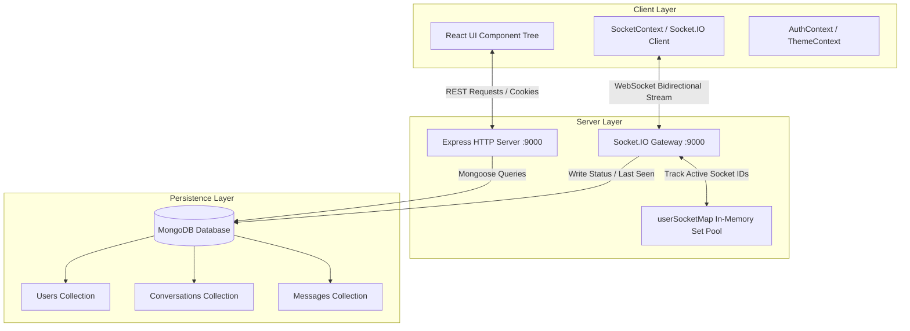

# 💬 Txtro — Production Real-Time Chat Platform

A modern, full-stack, real-time messaging application engineered with **Node.js, Express, MongoDB, Socket.IO, React, Vite, and Tailwind CSS v4**. Built from the ground up to mirror the responsiveness, feature completeness, and visual polish of platforms like **WhatsApp** and **Telegram**.

---

## 📑 Table of Contents

- [Overview](#-overview)
- [Rollout Release Methodology](#-rollout-release-methodology)
- [Tech Stack](#-tech-stack)
- [System Architecture](#-system-architecture)
- [Rollout 1: Essential Features Oriented (Phases 1 to 7)](#-rollout-1-essential-features-oriented-phases-1-to-7)
  - [Phase 1: Date Separators & Chat Grouping](#phase-1-date-separators--chat-grouping)
  - [Phase 2: Live Typing Indicators](#phase-2-live-typing-indicators)
  - [Phase 3: Last Message & Unread Badges in Sidebar](#phase-3-last-message--unread-badges-in-sidebar)
  - [Phase 4: Message Status & Read Receipts (Single/Double/Blue Ticks)](#phase-4-message-status--read-receipts)
  - [Phase 5: Persistent Online Presence & Last Seen Tracking](#phase-5-persistent-online-presence--last-seen-tracking)
  - [Phase 6: Native Mobile App UX & PWA](#phase-6-native-mobile-app-ux--pwa)
  - [Phase 7: Dark & Light Mode Theme Engine](#phase-7-dark--light-mode-theme-engine)
- [Database Schema & Indexing](#-database-schema--indexing)
- [REST API Reference](#-rest-api-reference)
- [Socket.IO Real-Time Event Matrix](#-socketio-real-time-event-matrix)
- [Project Directory Structure](#-project-directory-structure)
- [Getting Started & Installation](#-getting-started--installation)

---

## 🧭 Rollout Release Methodology

All future features and architectural upgrades in this project follow our strict **7-Phase Rollout Framework**:
1. **Fixed 7-Phase Structure:** Every major release milestone is bundled strictly into **exactly 7 distinct phases**.
2. **Context-Driven Naming:** Each Rollout receives a dedicated name and theme determined by the collective purpose of its 7 phases (e.g., *Rollout 1: Essential Features Oriented*).
3. **Rigorous Quality Gate:** A Rollout is only marked complete once all 7 phases have passed end-to-end integration, database synchronization, and production build checks.

---

## 🌟 Overview

Txtro provides instantaneous bidirectional communication with enterprise-grade state synchronization between in-memory WebSocket connections and MongoDB persistence. It includes features such as:
- Multi-device socket session pooling
- Real-time read receipts with single, double, and sky-blue ticks
- Live debounced typing indicators
- Persistent "last seen" tracking across reconnects
- Unread message counters aggregated in $O(1)$ query complexity
- Native PWA installation and mobile safe-area viewport responsiveness
- Theme engine toggling between sleek dark mode and clean light mode

---

## 🛠️ Tech Stack

### Backend
- **Runtime Environment:** Node.js (ES Modules)
- **Web Framework:** Express.js 5.x
- **Database:** MongoDB via Mongoose ODM
- **Real-Time Engine:** Socket.IO 4.x with `@socket.io/admin-ui` instrumentation
- **Authentication & Security:** JWT stored in `httpOnly` secure cookies, `bcryptjs` password hashing, CORS configuration with credentials support
- **Error Handling:** Centralized async wrapper (`express-async-handler`) and custom `ErrorHandler` / `ApiResponse` classes

### Frontend
- **Framework & Build Tool:** React 19 + Vite 8
- **Styling:** Tailwind CSS v4 with custom dark mode variants and CSS variables
- **Routing:** React Router DOM v7
- **Icons:** Lucide React
- **Notifications:** React Hot Toast
- **HTTP Client:** Axios with credentials handling (`withCredentials: true`)
- **PWA Capabilities:** Standalone Web App Manifest, viewport-fit cover, dynamic mobile theme-color syncing

---

## 🏗️ System Architecture



## 🚀 Rollout 1: Essential Features Oriented (Phases 1 to 7)

### Phase 1: Date Separators & Chat Grouping
- **Core Problem:** Raw message arrays lacked temporal context, making long conversations hard to navigate.
- **Solution:** Messages are dynamically grouped by calendar day using utility functions in `client/src/utils/date.js`.
- **Formatting Rules:**
  - Same calendar day as current date $\rightarrow$ **"Today"**
  - Exactly 1 day prior $\rightarrow$ **"Yesterday"**
  - Within the last 7 days $\rightarrow$ Day name (e.g., **"Monday"**)
  - Older than 7 days $\rightarrow$ **"DD/MM/YYYY"**
- **UI Implementation:** Centered frosted glass pill badge (`DateSeparator.jsx`) with light and dark mode styling.

---

### Phase 2: Live Typing Indicators
- **Core Problem:** Users couldn't see when their chat partner was actively typing.
- **Solution:** Real-time socket events with debounce control.
- **Data Flow:**
  1. Sender types in `MessageInput.jsx`: emits `socket.emit("typing", { receiverId })`.
  2. A 2.5-second inactivity timeout (`typingTimeoutRef`) resets on every keystroke. If no key is pressed or the message is sent, `socket.emit("stopTyping", { receiverId })` is dispatched.
  3. Server relays `userTyping` and `userStoppedTyping` to all socket IDs registered for that recipient.
  4. Header displays an animated green `"Typing..."` pulse, while the chat stream shows a 3-dot bouncing bubble (`animate-bounce`).

---

### Phase 3: Last Message & Unread Badges in Sidebar
- **Core Problem:** Sidebar contact lists were static and did not show conversation context or unread indicators.
- **Solution:** High-performance MongoDB aggregation pipeline at `GET /api/v1/users/all/metadata`:
  - **Parallel Execution:** `Promise.all` fires user queries, conversation lookups, and unread aggregations simultaneously.
  - **Aggregation Pipeline:** A single `$group` query matches `{ receiverId: loggedInUserId, status: { $ne: "read" } }` to compute unread counts in one pass.
  - **In-Memory $O(1)$ Hash Maps:** Replaced $O(N)$ query loops with JavaScript `Map()` objects to merge metadata in microseconds.
  - **Pagination:** Supports `page` and `limit` query parameters with `hasMore` and `totalPages`.
  - **UI Badge:** Unread count displays in an indigo pill badge; outgoing messages prefix with `"You: "`.

---

### Phase 4: Message Status & Read Receipts
- **Core Problem:** Senders couldn't verify if their message was sent, delivered to an online device, or read.
- **Solution:** 3-tier message lifecycle:
  | Status | Icon | Condition |
  | :--- | :--- | :--- |
  | `sent` | 1 Grey Tick (`<Check size={13} />`) | Saved in DB; recipient offline |
  | `delivered` | 2 Grey Ticks (`<CheckCheck size={13} />`) | Recipient is online in `userSocketMap` |
  | `read` | 2 Sky Blue Ticks (`<CheckCheck size={13} className="text-sky-300" />`) | Recipient opened conversation |
- **Event Flow:**
  - `sendMessage`: Server checks `userSocketMap[receiverId]`. If online, sets `status: "delivered"` immediately and emits `newMessage`.
  - `getMessage` / `markAsRead`: When the recipient opens the chat, MongoDB updates all messages `{ receiverId: myId, status: { $ne: "read" } }` to `"read"` and emits `messageSeen` back to the sender's active sockets.

---

### Phase 5: Persistent Online Presence & Last Seen Tracking
- **Core Problem:** In-memory socket maps vanish on server restarts, and closing tabs left users permanently marked "Offline" without timestamps.
- **Solution:** Multi-device session pooling connected directly to MongoDB persistence:
  - **Multi-Tab Pool:** Each user ID maps to a `Set` of socket IDs: `userSocketMap[userId] = new Set(["socketId1", "socketId2"])`.
  - **Connection (`size === 1`):** When the first tab connects, DB updates `{ isOnline: true }`, broadcasting `userStatusUpdate`.
  - **Disconnection (`size === 0`):** When the last tab disconnects, DB updates `{ isOnline: false, lastSeen: new Date() }`, broadcasting `userStatusUpdate`.
  - **Smart Formatting (`formatLastSeen`):**
    - "Online" (active)
    - "Last seen today at 4:15 PM"
    - "Last seen yesterday at 10:00 AM"
    - "Last seen on 12 Oct at 3:30 PM"

---

### Phase 6: Native Mobile App UX & PWA
- **Core Problem:** Mobile browsers resize viewports unexpectedly when on-screen keyboards open, and navigation bars cause layout jumping.
- **Solution:** Native mobile optimization:
  - **Dynamic Viewport (`100dvh`):** Replaced legacy `100vh` across `html, body, #root, HomePage.jsx` to prevent keyboard jump glitches.
  - **Safe Area Insets:** Added `pb-[max(0.75rem,env(safe-area-inset-bottom))]` in `MessageInput.jsx` for iPhone home indicator bars.
  - **PWA Manifest:** Added `client/public/manifest.json` configured with `display: "standalone"`, allowing users to install to their home screen without browser address bars.
  - **Mobile Touch Tweaks:** Configured `-webkit-tap-highlight-color: transparent` and `overscroll-behavior-y: none`.

---

### Phase 7: Dark & Light Mode Theme Engine
- **Core Problem:** Fixed dark theme prevented light mode accessibility.
- **Solution:** Full theme system integrated with Tailwind CSS v4:
  - **Variant Configuration:** Configured `@custom-variant dark (&:where(.dark, .dark *));` in `index.css`.
  - **Global Context (`ThemeContext.jsx`):** Persists theme preference (`'dark'` | `'light'`) in `localStorage('chat_theme')`.
  - **Dynamic Mobile Status Bar:** Automatically updates `<meta name="theme-color">` (`#020617` in dark mode, `#f8fafc` in light mode).
  - **Header Toggle:** Sun/Moon toggle button in the sidebar profile header with smooth micro-transitions.
  - **Custom Scrollbars:** Tailored slim scrollbars adapting colors across both themes.

---

## 🗄️ Database Schema & Indexing

### 1. User Schema (`userModel`)
```javascript
{
  username: { type: String, required: true, unique: true, trim: true, lowercase: true },
  fullname: { type: String, required: true },
  password: { type: String, required: true, minlength: 6 },
  isOnline: { type: Boolean, default: false },
  lastSeen: { type: Date, default: Date.now },
  timestamps: true
}
```

### 2. Message Schema (`messageModel`)
```javascript
{
  conversationId: { type: Schema.Types.ObjectId, ref: "Conversation", required: true },
  senderId: { type: Schema.Types.ObjectId, ref: "User", required: true },
  receiverId: { type: Schema.Types.ObjectId, ref: "User", required: true },
  message: { type: String, required: true, trim: true },
  status: { type: String, enum: ["sent", "delivered", "read"], default: "sent" },
  timestamps: true
}
```
**Indexes:** Compound index on `{ conversationId: 1, receiverId: 1, status: 1 }` for instant unread message aggregation.

### 3. Conversation Schema (`conversationModel`)
```javascript
{
  participants: [{ type: Schema.Types.ObjectId, ref: "User" }],
  lastMessage: { type: Schema.Types.ObjectId, ref: "Message" },
  timestamps: true
}
```
**Indexes:** Compound index on `{ participants: 1, updatedAt: -1 }`.

---

## 📡 REST API Reference

### Authentication Routes (`/api/v1/users`)
| Method | Endpoint | Access | Description |
| :--- | :--- | :--- | :--- |
| `POST` | `/register` | Public | Register new user account |
| `POST` | `/login` | Public | Authenticate user & set JWT cookie |
| `POST` | `/logout` | Private | Clear JWT authentication cookie |
| `GET` | `/me` | Private | Retrieve logged-in user profile |

### User Directory Routes (`/api/v1/users`)
| Method | Endpoint | Access | Description |
| :--- | :--- | :--- | :--- |
| `GET` | `/all` | Private | Get all users (excluding current user) |
| `GET` | `/all/metadata` | Private | Paginated users with last message & unread badge count |

### Message Routes (`/api/v1/messages`)
| Method | Endpoint | Access | Description |
| :--- | :--- | :--- | :--- |
| `POST` | `/send/:id` | Private | Send message to user `:id` |
| `GET` | `/:id` | Private | Get chat history with user `:id` & mark unreads as read |

---

## ⚡ Socket.IO Real-Time Event Matrix

| Event Name | Direction | Payload | Description |
| :--- | :--- | :--- | :--- |
| `connection` | Client $\rightarrow$ Server | Query: `{ userId }` | Registers user's active socket session in `userSocketMap` |
| `getOnlineUsers` | Server $\rightarrow$ Client | `string[]` (userIds) | Emits list of all currently connected online users |
| `typing` | Client $\rightarrow$ Server | `{ receiverId }` | Emitted when user types into message input |
| `userTyping` | Server $\rightarrow$ Client | `{ senderId }` | Broadcast to recipient's sockets to render "Typing..." |
| `stopTyping` | Client $\rightarrow$ Server | `{ receiverId }` | Emitted when user stops typing or clears input |
| `userStoppedTyping` | Server $\rightarrow$ Client | `{ senderId }` | Broadcast to recipient's sockets to clear typing bubble |
| `markAsRead` | Client $\rightarrow$ Server | `{ conversationId, senderId }` | Marks messages as read in DB when chat is opened |
| `messageSeen` | Server $\rightarrow$ Client | `{ conversationId, seenBy }` | Notifies original sender to turn ticks sky-blue |
| `userStatusUpdate`| Server $\rightarrow$ Client | `{ userId, isOnline, lastSeen }`| Broadcasts live status changes when a user connects/disconnects |
| `disconnect` | Client $\rightarrow$ Server | None | Removes socket from pool; updates DB if all tabs closed |

---

## 📂 Project Directory Structure

```
SOCKET_PRACTICE/
├── client/
│   ├── public/
│   │   ├── manifest.json            # PWA standalone manifest
│   │   └── vite.svg
│   ├── src/
│   │   ├── api/
│   │   │   └── api.js               # Axios instance & REST endpoints
│   │   ├── components/
│   │   │   ├── chat/
│   │   │   │   ├── ChatContainer.jsx # Main chat stream container
│   │   │   │   ├── ChatHeader.jsx    # Header with presence, typing, calls
│   │   │   │   ├── DateSeparator.jsx # Grouped date pill badges
│   │   │   │   ├── MessageBubble.jsx # Message bubbles with status ticks
│   │   │   │   ├── MessageInput.jsx  # Input bar with safe area insets
│   │   │   │   ├── NoChatSelected.jsx# Empty state illustration
│   │   │   │   └── Sidebar.jsx       # Contact list, search, unread counts
│   │   │   └── common/
│   │   │       ├── AuthCard.jsx
│   │   │       ├── Button.jsx
│   │   │       └── InputField.jsx
│   │   ├── context/
│   │   │   ├── AuthContext.jsx       # User auth state provider
│   │   │   ├── SocketContext.jsx     # WebSocket connection provider
│   │   │   └── ThemeContext.jsx      # Dark/Light mode theme provider
│   │   ├── pages/
│   │   │   ├── HomePage.jsx          # Primary chat screen layout
│   │   │   ├── Login.jsx             # Login view
│   │   │   └── Register.jsx          # Register view
│   │   ├── utils/
│   │   │   └── date.js               # formatChatDate & formatLastSeen helpers
│   │   ├── App.jsx                   # Application routing
│   │   ├── index.css                 # Tailwind v4 custom variants & 100dvh
│   │   └── main.jsx                  # Entry point wrapping all providers
│   ├── index.html                    # Viewport-fit cover & mobile theme tags
│   └── package.json
│
└── server/
    ├── src/
    │   ├── config/
    │   │   └── db.js                 # MongoDB connection logic
    │   ├── controllers/
    │   │   ├── message.controller.js # Send & fetch messages, read receipts
    │   │   └── user.controller.js    # Auth & getAllUsersWithMetadata pipeline
    │   ├── middlewares/
    │   │   ├── authenticate.middleware.js # JWT verification
    │   │   └── error.middleware.js   # Centralized error handler
    │   ├── models/
    │   │   ├── conversation.model.js # Conversation schema & indexes
    │   │   ├── message.model.js      # Message schema & indexes
    │   │   └── user.model.js         # User schema & presence tracking
    │   ├── routes/
    │   │   ├── message.routes.js     # Message route definitions
    │   │   └── user.routes.js        # User route definitions
    │   ├── socket/
    │   │   └── socket.js             # Socket.IO lifecycle & presence management
    │   ├── utils/
    │   │   ├── ApiResponse.js        # Standardized API response format
    │   │   ├── ErrorHandler.js       # Standardized API error format
    │   │   └── generateToken.js      # JWT generator
    │   ├── app.js                    # Express application configuration
    │   └── server.js                 # HTTP & Socket server bootstrap
    ├── package.json
    └── .env                          # Server environment configuration
```

---

## 💻 Getting Started & Installation

### Prerequisites
- Node.js (v18.0.0 or higher)
- MongoDB instance (Local or MongoDB Atlas cluster)

### 1. Clone & Setup Backend
```bash
cd server
npm install
```

Create a `.env` file in the `server` directory:
```env
PORT=9000
MONGO_URI=mongodb://127.0.0.1:27017/socket_practice
JWT_SECRET=your_super_secret_jwt_key
MAX_AGE=24
NODE_ENV=development
```

Start the backend development server:
```bash
npm run dev
```
*(Backend runs on `http://localhost:9000` with Socket.IO Admin UI on `/`)*

---

### 2. Setup Frontend
In a new terminal:
```bash
cd client
npm install
npm run dev
```
*(Frontend runs on `http://localhost:5173`)*

---

### 3. Testing Real-Time Scenarios
1. Open `http://localhost:5173` in a standard browser window and register **User A**.
2. Open `http://localhost:5173` in an Incognito window and register **User B**.
3. Select each other from the sidebar:
   - Notice User B appears as **"Online"** in User A's header.
   - Start typing in User A's input box $\rightarrow$ User B sees **"Typing..."** in both the header and chat stream.
   - Send a message $\rightarrow$ single check turns to **double check** immediately.
   - Open the conversation in User B $\rightarrow$ ticks turn **sky blue** in real time!
   - Close User B's Incognito window $\rightarrow$ User A's header dynamically switches to **"Last seen today at [time]"**!
   - Click the **Sun/Moon** icon in the sidebar to toggle between sleek dark mode and light mode.
